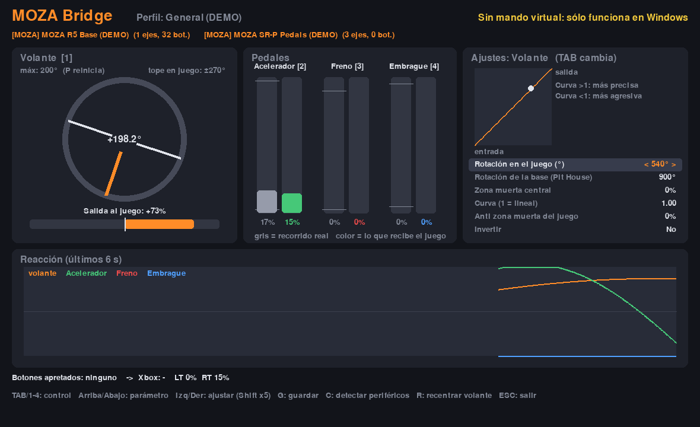

# MOZA Bridge

Usá tu volante y pedales **MOZA** en juegos que no soportan volante (por
ejemplo **Need for Speed Heat**), con control **analógico real**: el juego
recibe exactamente cuánto giraste y cuánto pisaste, no un "tecla apretada / no
apretada" como cuando se emula el teclado.

El programa:

- **Detecta solo** la base, los pedales y los botones (también si los pedales
  van por USB aparte, o si tenés freno de mano / pedales de otra marca).
- Muestra **en vivo** los grados que giraste el volante, el recorrido real de
  cada pedal y lo que recibe el juego, con un gráfico de los últimos 6 segundos
  para ver la reacción.
- Permite ajustar la **sensibilidad**: rotación en el juego, zonas muertas,
  saturación, curva de respuesta y compensación de la zona muerta del juego.
- Crea un **mando de Xbox 360 virtual** (volante → stick izquierdo,
  acelerador → RT, freno → LT, botones del volante → A/B/X/Y/etc.).



> Limitación: el *force feedback* no pasa al juego, porque el juego cree que
> está hablando con un mando de Xbox. Los efectos del volante los seguís
> configurando en Pit House (amortiguación, fricción, etc.).

---

## 1. Instalación (Windows 10/11, una sola vez)

1. Instalá **Python 3.10 o superior** desde <https://www.python.org/downloads/>.
   En el instalador tildá **"Add python.exe to PATH"**.
2. Descargá este proyecto (botón verde *Code → Download ZIP*) y descomprimilo.
3. Hacé doble clic en **`instalar.bat`**. Instala `pygame` y `vgamepad`.
   La primera vez `vgamepad` abre el instalador del driver **ViGEmBus**
   (el que crea el mando virtual): aceptalo y reiniciá si lo pide.
   Si no se abre, instalalo a mano desde
   <https://github.com/nefarius/ViGEmBus/releases>.
4. *(Muy recomendado)* Instalá **HidHide**
   (<https://github.com/nefarius/HidHide/releases>). Sirve para que el juego
   **no vea** el volante real y sólo vea el mando virtual; si no, algunos
   juegos (NFS Heat incluido) mezclan las dos entradas y la dirección se
   vuelve loca. Ver el paso 4.

En **Pit House**:

- Desactivá cualquier modo de **emulación de teclado** que estuvieras usando.
- Anotá la **rotación máxima del volante** (ej. 900°). El programa la estima
  solo, pero conviene confirmarla.
- Dejá Pit House abierto o cerrado, da igual: el programa lee la base como
  controlador de juego de Windows.

## 2. Primera vez: detección automática

Doble clic en **`iniciar.bat`**. Si no hay nada calibrado arranca solo el
asistente (también se abre con la tecla **C**). Te va a pedir:

1. Soltar los pedales y dejar el volante centrado → **ESPACIO**.
2. Pisar a fondo el **acelerador** → ESPACIO (sin soltarlo).
3. Pisar a fondo el **freno** → ESPACIO.
4. Pisar el **embrague** → ESPACIO (o **S** si no tenés).
5. Girar el volante **90° a la derecha** (la marca superior del aro apuntando
   a las 3 en punto) → ESPACIO. Con esto detecta el eje, el sentido y estima la
   rotación de la base.
6. Apretar el botón del volante que querés para cada acción (freno de mano,
   nitro, cámara, ...). **S** para saltar.

Se guarda en `perfiles/general.json`. Los perfiles de cada juego **heredan**
esta detección, así que se hace una sola vez.

Si algo no se detecta, ejecutá **`diagnostico.bat`**: genera
`diagnostico.txt` con la lista de periféricos, sus IDs (VID/PID) y ejes.

## 3. Ajustar la sensibilidad

| Tecla | Acción |
|---|---|
| `TAB` / `1`-`4` | Elegir volante, acelerador, freno o embrague |
| `↑` `↓` | Elegir parámetro |
| `←` `→` | Cambiar valor (`Shift` = pasos x5) |
| `G` | Guardar perfil |
| `C` | Volver a detectar periféricos |
| `R` | Recentrar el volante (dejalo derecho y apretá R) |
| `P` | Reiniciar el máximo de grados registrado |
| `ESC` | Salir |

**Volante**

- **Rotación en el juego**: cuántos grados de volante hacen falta para llegar
  al tope en el juego. Menos = dirección más rápida. Para juegos arcade
  (NFS) andan bien 270–450°; para algo más realista 540–900°.
- **Rotación de la base**: tiene que coincidir con la de Pit House, si no los
  grados que se muestran no son reales.
- **Zona muerta central**: ignora movimientos chicos en el centro.
- **Curva**: 1 = lineal. Mayor a 1 = más suave cerca del centro (más precisión
  en recta); menor a 1 = más agresiva.
- **Anti zona muerta**: muchos juegos ignoran el primer tramo del stick; esto
  lo compensa. Si al girar un poco el auto no reacciona, subila de a 2–5 %.

**Pedales** (la barra gris es el recorrido real, la de color lo que recibe el juego)

- **Zona muerta inicial**: evita que el pedal "acelere solo" en reposo.
- **Saturación**: en qué punto del recorrido ya cuenta como 100 %. Útil en el
  freno con celda de carga (no hace falta pisar con toda la fuerza).
- **Curva**: mayor a 1 = progresivo (más control al principio del pedal).
- **Salida al mando**: RT, LT o ninguna.

## 4. Need for Speed Heat

1. Abrí **`iniciar_nfs_heat.bat`** (perfil con dirección a 360°, freno un
   poco progresivo). Ajustalo mirando el gráfico y apretá `G` para guardar.
2. En **HidHide** (*HidHide Configuration Client*):
   - Pestaña *Applications*: es la lista de programas **autorizados** a ver
     los dispositivos ocultos. Agregá `python.exe` (para saber dónde está,
     ejecutá `where python` en una consola) y el `.exe` de **Pit House**.
   - Pestaña *Devices*: tildá la base y los pedales MOZA y activá
     *Enable device hiding*.
   - Así el juego sólo ve el mando virtual. Para volver a usar el volante
     normal en juegos compatibles, destildá *Enable device hiding*.
3. Abrí el juego con MOZA Bridge corriendo. En *Opciones → Controles* debería
   figurar un mando de Xbox. Recomendado en el juego:
   - **Zona muerta de dirección**: 0 (la manejás desde MOZA Bridge).
   - **Sensibilidad de dirección**: alta; ajustá la respuesta desde acá.
4. Los botones del perfil (A = freno de mano, B = nitro, etc.) siguen la
   asignación por defecto del mando; si en tu versión del juego son otros,
   cambialos en *Opciones → Controles* o volvé a detectar con `C`.

Con este perfil también podés jugar cualquier otro juego que acepte mando de
Xbox. Para crear un perfil nuevo copiá `perfiles/nfs_heat.json` con otro
nombre y abrilo con `python -m moza_bridge --perfil mi_juego`.

## Opciones de línea de comandos

```
python -m moza_bridge --perfil nfs_heat   # usar un perfil
python -m moza_bridge --listar            # diagnóstico de periféricos
python -m moza_bridge --sin-salida        # sólo ver los valores, sin mando virtual
python -m moza_bridge --demo              # probar la interfaz sin volante
```

## Problemas comunes

- **"Falta vgamepad/ViGEmBus"**: volvé a correr `instalar.bat` o instalá
  ViGEmBus a mano.
- **El juego no responde al volante**: el programa tiene que estar abierto
  mientras jugás (puede quedar minimizado).
- **La dirección va al revés**: en ajustes del volante cambiá *Invertir*.
- **Los grados no coinciden con el giro real**: corregí *Rotación de la base*
  para que sea la misma que en Pit House.
- **El juego reacciona doble o raro**: el juego está leyendo también el
  volante real → configurá HidHide (paso 4).

## Para desarrolladores

```
pip install pygame pytest
python -m pytest
```

Estructura: `devices.py` (detección), `calibrate.py` (asistente),
`processing.py` (curvas), `engine.py` (lectura → proceso → salida),
`output.py` (mando virtual), `gui.py` (interfaz).
